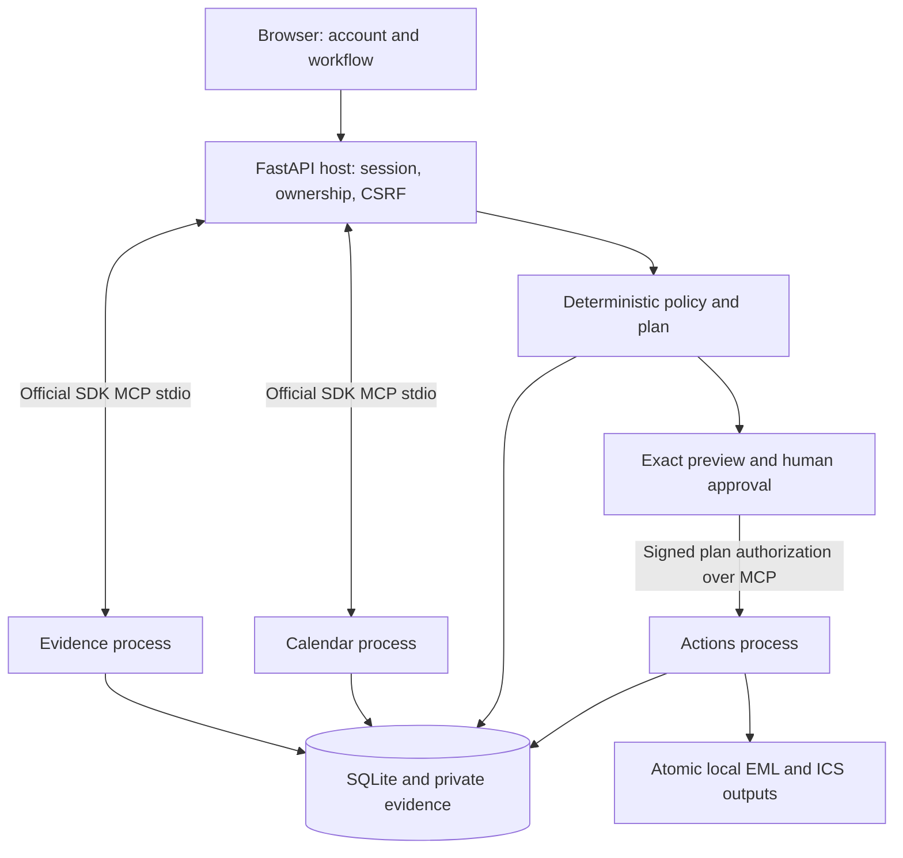

# ReturnRelay 2.0

**Intelligent Returns. Verified Evidence. Secure Actions.**

ReturnRelay manages purchase evidence, explainable eligibility, exact-plan human approval, local email/calendar preparation, return progress and refund evidence. It runs without paid APIs. The three original official-SDK MCP subprocesses remain the real communication boundary.

## Run on Windows PowerShell

Requires Python 3.12. In the project directory:

```powershell
py -3.12 -m venv .venv
.\.venv\Scripts\python.exe -m pip install -r requirements.txt
Copy-Item .env.example .env
.\.venv\Scripts\python.exe host.py
```

Open **http://127.0.0.1:8000**. Register your own account with a password of at least ten characters. Accounts start empty. **Settings → Load fictional examples** adds the four original demonstration purchases to your own account. No shared password is shipped.

For the prepared checkout on this machine:

```powershell
Set-Location C:\fscr\mcpserver
.\.venv\Scripts\python.exe host.py
```

Use one worker. An alternative port is supported:

```powershell
.\.venv\Scripts\python.exe -m uvicorn host:app --host 127.0.0.1 --port 8001 --workers 1
```

The default bind is localhost. Docker remains supported; publish only locally with `docker run -p 127.0.0.1:8000:8000 returnrelay`. Persistent deployments must mount `/app/data`. Container loopback is not the host loopback.

## Problem and solution

Returning a purchase involves receipts, policy terms, deadlines, availability, correspondence and refund follow-up. ReturnRelay assembles that evidence into a reviewable plan. Rules decide whether a plan can proceed. Human consent authorizes the exact local outputs. Merchant processing and user-verified bank evidence remain distinct.

No actual recovered money, customer adoption, guaranteed refund, merchant API connection or pickup booking is claimed.

## Working features

- Account registration/sign-in, scrypt password hashing, HttpOnly sessions and per-session CSRF tokens.
- Ten working navigation sections with responsive teal/green dashboard, database counts, charts, alerts and activity.
- Purchase search, sorting, status filters, details, manual date corrections and versioned policy capture.
- Eleven-step return workflow, persistent saved drafts, blocked-case recording, plan preview, rejection and approval.
- PDF/JPEG/PNG upload, validation, private storage, deterministic labelled-field extraction and explicit confirmation.
- Deterministic assistant grounded in MCP purchase, policy and refund records; optional local Ollama explanations.
- Three actual MCP processes, tool discovery and schemas, timed calls, real ping health and persistent redacted invocation records.
- HMAC-bound approvals, expiry, evidence/policy rechecks, calendar conflict rechecks and atomic idempotent EML/ICS preparation.
- Persistent return timelines, user-recorded submission and merchant responses, refund documents and explicit bank-document verification.
- Evidence vault for receipts, policies, plans, responses and verification records; authenticated original document download.
- Date-filtered return analytics. Purchase eligibility and merchant distributions are separately labelled as all-purchase measures.

## Five demonstration scenarios

1. **Eligible:** Settings → load examples. New Return → Everyday headphones / RR-1042 → continue through the eleven steps. Review receipt, versioned policy and the 18:00–18:30 preparation slot. Tick exact-plan approval and prepare. Download EML and ICS. Retry returns the original pair.
2. **Expired:** select RR-1043. Eligibility explains the expired 8 November deadline and disables preparation. Save the blocked case to tracking.
3. **Unclear:** select RR-1045. The missing policy window requires human review. Replacement-only RR-1044 is another stop case.
4. **MCP action failure:** at final approval tick the failure demonstration. The real Actions MCP tool errors and rolls back without outputs. Untick, approve again, then retry to show no duplicate pair. MCP Activity shows actual failed and successful calls. This simulates an operation failure, not an operating-system process crash. A disconnected process fails closed; restart the host to reconnect.
5. **Refund evidence:** Refund Tracker shows the fictional merchant processing notice for RR-1042 with bank credit unverified. Upload a document in Evidence Vault and choose “Use as refund evidence” → associate RR-1042. In Refund Tracker record merchant processing separately from bank-credit verification. Verification requires that document, matching amount, transaction reference and explicit user confirmation. This is user document verification, never independent bank confirmation.

The original fixtures are unchanged and use a fixed **24 November 2026, 10:00 IST** scenario clock. Real user receipts use the current clock. Approvals always expire against real time.

## Receipt processing

Upload a real document or the clearly fictional `samples/fictional-receipt.pdf`. Text-layer PDFs extract locally with pypdf. Images use Pillow and optional Tesseract OCR. Install the Tesseract executable separately and put it on PATH to enable image text recognition; pytesseract alone does not install the OCR engine. Without it, images remain available for manual field review. Scanned PDFs without a text layer require image upload or manual fields.

Labels such as `Order ID:`, `Merchant:`, `Product:`, ISO dates, `Total: INR 499.00` and payment references are recognized. Unlabelled or unsupported layouts may require manual entry. Confidence 0.85 is a heuristic field-match indicator, not a calibrated probability. Missing values are null; nothing is invented. All fields require explicit confirmation. A support email is entered by the user from trusted merchant evidence.

Uploads: maximum 10 MB, at most 20 PDF pages, unencrypted PDF, JPEG/PNG content validation and bounded image dimensions. File names become random IDs. Originals are never mounted as public static files. Original downloads are attachments; the vault previews extracted text and structured metadata. Documents are stored unencrypted on the local disk, subject to OS permissions; use disk encryption for sensitive documents.

## Policy evaluation

Statuses: ELIGIBLE, EXPIRED, NOT_ELIGIBLE, REPLACEMENT_ONLY, HUMAN_REVIEW_REQUIRED, INSUFFICIENT_EVIDENCE. Decisions include explanation, policy/version, supporting IDs, deadline, missing information and next step.

The supported automatic rule is delivery date plus stated calendar days, ending at 23:59 Asia/Kolkata, with unused condition and original packaging/accessories. Excluded categories block. Unknown terms, exceptions and conflicting terms require review. Real merchant policies are **user-provided quotations**, not fetched from an invented merchant API. Policies with other cutoff/condition semantics must be recorded as exceptions and reviewed. A new policy version or corrected purchase invalidates an old plan. No LLM can override rules.

## Architecture and MCP



Each process performs a real initialization handshake, capability negotiation and `tools/list`; calls use `tools/call`. SDK 1.29.0 negotiated protocol 2025-11-25 in this environment. There is no direct-function replacement for MCP calls.

| Process | Discovered tools |
|---|---|
| Evidence | list_orders, get_evidence, validate_evidence, get_receipts, get_refund_evidence |
| Calendar | get_busy_slots, find_available_slot, validate_slot |
| Actions | prepare_approved_outputs, validate_approval, action_status |

Evidence combines order and versioned-policy retrieval. Calendar slots are preparation suggestions. The action tool prepares both outputs together after verification. Only host and Actions receive the signing key; read services do not. These subprocesses share a trusted local OS account and database. They are not hardened OS security containers.

MCP Activity separates ping responsiveness, connection state, tool `ok` and business outcome. Actual parameter structures, durations and response structures are stored, with approval tokens, receipt prose, message bodies and addresses redacted. Current tool schemas come from real discovery. The latest 200 account calls are displayed; SQLite history persists across restarts. Invocation history is application tracing, not a complete packet capture or tamper-proof ledger.

## SQLite and migrations

`storage.migrate()` runs an additive, idempotent migration at startup. Existing plans, actions, audit records and fixture JSON are retained. Back up the database and uploads together before changing versions. Foreign keys and owner indexes are enabled; transactions commit/rollback and close deterministically on Windows.

| Tables | Purpose |
|---|---|
| users, sessions | Accounts, scrypt hashes, hashed session IDs, CSRF and expiry |
| purchases, merchant_policies | Composite account/order keys and versioned policy snapshots |
| evidence_records, receipts | Account-scoped metadata, confirmation and private file locations |
| return_requests, return_history | Drafts, preview references and lifecycle timeline |
| plans, approvals, actions | Exact stored plans, human approval records, unique output per plan |
| calendar_slots | Account-scoped busy intervals |
| refund_records | Merchant state and user document verification |
| audit, audit_logs, mcp_events | Legacy demo events, account activity and redacted real tool calls |
| schema_migrations | Applied migration version |

Legacy plans remain fictional, unowned demo data. New account data is never returned by legacy demo routes. New workflow rows own their plan through the stored user ID; original plan/action table compatibility is retained.

## API

Interactive documentation: http://127.0.0.1:8000/docs . Schemas: `/openapi.json`.

All `/api/v2` business endpoints require a session. POSTs require `X-CSRF-Token` returned by authentication. Authentication endpoints accept JSON and block cross-site browser login. Session lifetime is twelve hours.

| Route group | Operations |
|---|---|
| /api/v2/auth/register, /login, /me, /logout | Account and session |
| /api/v2/demo | Explicit fictional fixture import |
| /api/v2/purchases, /purchases/{id} | Purchases and receipt/policy details |
| /api/v2/purchases/{id}/details, /policy | Confirmed corrections and policy versions |
| /api/v2/evaluate, /drafts, /plans | Rule decision, persistent draft, preview |
| /api/v2/plans/{id}, /plans/{id}/approve | Owned preview, reject or exact-plan approve |
| /api/v2/calendar | Read/add local busy intervals |
| /api/v2/returns, /returns/{id}/status | Timeline and validated next steps |
| /api/v2/receipts, /receipts/{id}/confirm | Upload/extract and confirm purchase |
| /api/v2/evidence, /evidence/{id}/file, /attach | Private vault, download, association |
| /api/v2/refunds, /refunds/{order_id} | Evidence and verification states |
| /api/v2/assistant, /dashboard, /mcp, /settings | Grounded support, reports, monitoring, connection truth |
| /api/download/{action_id}/eml or /ics | Owned local artifact download |

Original `/api/bootstrap`, `/api/plan`, `/api/approve`, `/api/refund/{id}` and `/api/audit` remain restricted to fictional legacy records and the original request-token behavior. The new UI exclusively uses authenticated business routes. Errors use FastAPI `detail` responses, including validation, 401/403 session errors, 404 ownership-safe errors, 409 lifecycle conflicts and 429 limits.

## Security

Passwords use salted scrypt. Session identifiers are random and only hashes are stored. Cookies are HttpOnly and SameSite=Strict; use RR_SECURE_COOKIE=1 only with HTTPS. Requests use per-session CSRF tokens, trusted Host validation and browser security headers. The default app is for localhost, one worker, a trusted machine. No public hosting, account recovery/email verification, malware scanner, distributed rate limiter or independent security audit is claimed.

Approval includes a digest of the entire plan and expires in at most five minutes; plans expire in thirty. The action service checks token, current policy, current receipt hash and eligibility. Calendar conflicts are rechecked before approval. Unique plan ID plus BEGIN IMMEDIATE prevents duplicate output pairs. AI cannot sign. Files, plans, refunds, traces and actions enforce account ownership.

Rate limits are in-memory per host: ten authentication requests per IP/minute and sixty authenticated requests per user/minute. Restart clears those counters. Audit logs persist but are mutable by the machine owner. SQLite/local output atomicity is not a distributed transaction over external providers.

## Optional configuration and integrations

Copy `.env.example` to `.env`. RR_DB and RR_UPLOAD_ROOT configure private data locations. RR_APPROVAL_KEY can be set to a locally generated secret; otherwise it is random each startup, invalidating outstanding authorizations after restart. Existing prepared outputs remain downloadable.

For optional local Ollama, install Ollama and your chosen model separately, then set:

```powershell
$env:RR_LLM_PROVIDER = 'ollama'
$env:RR_LLM_MODEL = 'llama3.2'
.\.venv\Scripts\python.exe host.py
```

The adapter calls only localhost:11434. A strict Pydantic schema and source allowlist validate model output. The deterministic answer remains authoritative and the optional explanation is explicitly advisory. Missing model or invalid output falls back. No model is installed or claimed connected by default. Receipt data may be included in the local model context only when you enable this provider.

`adapters.py` defines merchant, calendar and output interfaces and an active LocalOutputAdapter. Gmail OAuth, Google Calendar OAuth and merchant/bank APIs are **not connected or implemented**. The UI accurately reports that state. Adding them requires OAuth consent, private token storage, provider IDs, idempotency and reconciliation; the existing signing gate must be retained. EML/ICS are the fully working no-credential integration path.

## Tests

```powershell
.\scripts\run_tests.ps1
# Or individually:
.\.venv\Scripts\python.exe -m unittest discover -s tests -v
.\.venv\Scripts\python.exe -m tests.test_mcp
.\.venv\Scripts\python.exe -m tests.test_api
```

See `docs/TEST_RESULTS.md` for actual baseline, final results and browser scope. Original tests are preserved. New tests use temporary databases and actual MCP services. Optional invalid/unavailable model tests simulate failures only; successful protocol tests use real subprocesses. `requirements.lock.txt` records the installed Windows Python 3.12 environment. `requirements.txt` is the portable install entry point.

## Source map

- `host.py`: FastAPI, three MCP client sessions, bounded timed calls, security headers and downloads.
- `core.py`: policy, slot planning, exact plans, HMAC, SQLite and idempotent execution.
- `mcp_service.py`: original three isolated SDK server roles, expanded tools.
- `api_v2.py`, `security.py`, `storage.py`: authenticated application API, sessions and additive schema.
- `receipts.py`, `assistant.py`, `adapters.py`: conservative extraction, grounded answers, local provider.
- `static/index.html`, `app.css`, `app.js`: complete browser app, no build tools or CDN required.
- `data/fixtures.json`: unchanged original fictional scenarios.
- `samples/`, `scripts/`, `tests/`, `docs/`: upload example, verification commands, tests and presentation guidance.

## Current limits

Merchant policies are user-recorded and support a deliberately narrow rule; other terms require review. OCR needs Tesseract and extraction needs manual confirmation. Bank verification is user attestation of a document and matching amount; partial-credit discrepancies require review. No real messages are sent or merchant appointments booked. The optional local LLM is supplementary and untrusted. A stopped MCP process requires host restart. Date filtering applies to return records, not historical recomputation of purchase eligibility. This is a runnable local competition application, not an audited public multi-tenant service.
# returnrelay

